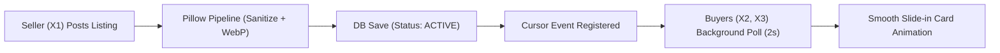

# ⚡ PreLoved – Second-Hand Goods Marketplace
> **Hyper-Local, Real-Time P2P Marketplace for Used Mobiles, Books, Furniture & More**  
> *Built with Python 3, Django, Bootstrap 5, JavaScript, SQLite3 & Pillow.*

---

## 🌟 Executive Overview & Key Features

**PreLoved** is a modern, responsive, hyper-local consumer-to-consumer marketplace. It empowers community members to buy and sell pre-owned items transparently and quickly.

### 🚀 Live marketplace feed
* **Automatic discovery:** New public listings are polled every two seconds without a page refresh.
* **Non-intrusive updates:** New cards are added with a short animation and a live-feed notice.
* **Efficient polling:** The feed endpoint returns only listing IDs newer than the browser's cursor, with a maximum batch of 20.

---

## 📑 Day 1 Documentation Index

All system specifications, algorithms, and designs are documented in detail:

1. [**Complete Master Specification & Architecture**](docs/DOCUMENTATION.md)
2. [**Database Entity-Relationship Diagram (ERD)**](docs/DOCUMENTATION.md#5-comprehensive-database-entity-relationship-diagram-erd)
3. [**Live Feed & Negotiation Algorithms**](docs/DOCUMENTATION.md#3-core-algorithms--detailed-pseudocode)
4. [**REST & Real-Time API Catalog**](docs/DOCUMENTATION.md#7-rest--real-time-api-endpoint-catalog)
5. [**5-Day Implementation Roadmap**](docs/DOCUMENTATION.md#10-5-day-delivery-schedule--milestones-tracker)

---

## 🛠️ Technology Stack

| Layer | Technology |
| :--- | :--- |
| **Backend Framework** | Python 3.11+, Django 5.x |
| **Database** | SQLite3 (Development / Zero-dependency) / PostgreSQL ready |
| **Media & Image Processing**| Pillow (PIL) – Auto EXIF Stripping, WebP/JPEG Resizing & Compression |
| **Frontend UI / UX** | HTML5, Modern CSS3, Bootstrap 5.3, Bootstrap Icons |
| **Design Aesthetics** | Minimalist Glassmorphism inspired by **21st.dev** and **Awwwards** |
| **Client Scripting** | Vanilla Modern JavaScript (ES6+), Fetch API, DOM Delta Engine |

---

## 🧩 System Modules

### 1. 🛡️ Admin Module
* **Category Governance:** Add, edit, activate/deactivate item categories with custom icons.
* **Listing Moderation:** Review flagged listings, approve or delete prohibited/fake goods.
* **User Management & Sanctions:** Block fraudulent users, audit reports, view platform analytics.
* **Live System Metrics:** Real-time counters for active listings, total offers, and reported items.

### 2. 👤 User Module (Buyer & Seller)
* **Authentication:** Secure registration, login, profile editing, and password management.
* **Seller Studio:** Multi-image upload with client and server-side preview, price setting, condition selector (`Brand New`, `Like New`, `Good`, `Fair`), and location tags.
* **Catalog Discovery:** Real-time search with live debouncing, category tabs, price range sliders, and city filtering.
* **Live Feed Engine:** Real-time incoming listing cards with custom animations.
* **Wishlist Engine:** Instant 1-click wishlist toggle with heart bounce animations.
* **Negotiation & Offers:** Buyers propose custom prices; Sellers accept, reject, or mark item as SOLD.
* **1-on-1 Chat:** Direct communication between buyer and seller linked to the specific item.
* **Reporting System:** Community reporting for suspicious, fake, or prohibited items.

---

## 🔄 Core Algorithms at a Glance



---

## ✅ Implemented marketplace workflows

* Search and filters for keyword, category, location, condition, price range, and sort order.
* Listing lifecycle controls for available, deal pending, sold, and archived listings.
* Wishlist, offers and counter-offers, listing-scoped buyer/seller messages, and community reports.
* Automatic hiding after three independent pending reports, staff moderation, and a staff analytics page.
* Uploaded listing images are orientation-corrected, resized, converted to WebP, and saved without EXIF metadata.

API endpoints are routed under `/api/v1/`; staff can use `/marketplace-analytics/` and Django Admin for moderation.

---

## 💻 Local Quickstart

### Prerequisites
* Python 3.10+
* Git

### Installation
```bash
# 1. Clone repository
git clone https://github.com/brainybeamGit/PreLoved-Django-P1.git
cd PreLoved-Django-P1

# 2. Create virtual environment
python -m venv venv
venv\Scripts\activate   # On Windows
source venv/bin/activate # On macOS/Linux

# 3. Install dependencies
python -m pip install -r requirements.txt

# 4. Apply database migrations
python manage.py migrate

# 5. (Optional) Create an admin account
python manage.py createsuperuser

# 6. Start the development server
python manage.py runserver
```
Visit `http://127.0.0.1:8000` to access the application.

In development, account activation and password-reset emails are printed to the runserver console. To send real email, set `EMAIL_BACKEND`, `EMAIL_HOST`, `EMAIL_HOST_USER`, `EMAIL_HOST_PASSWORD`, `EMAIL_PORT`, and `EMAIL_USE_TLS` in the environment; do not commit credentials.
