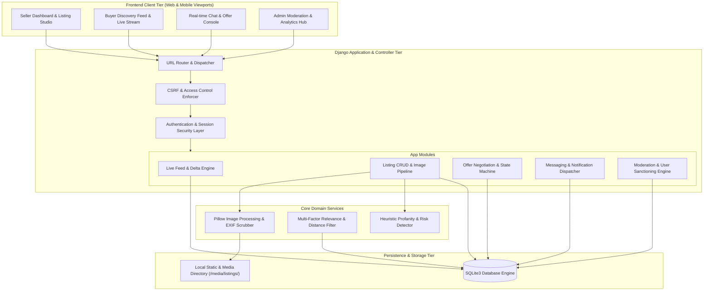
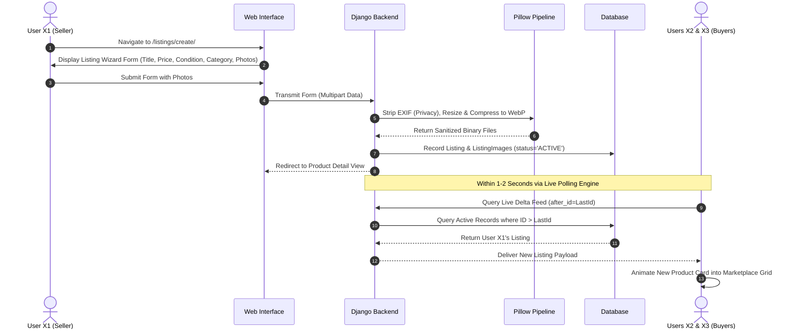
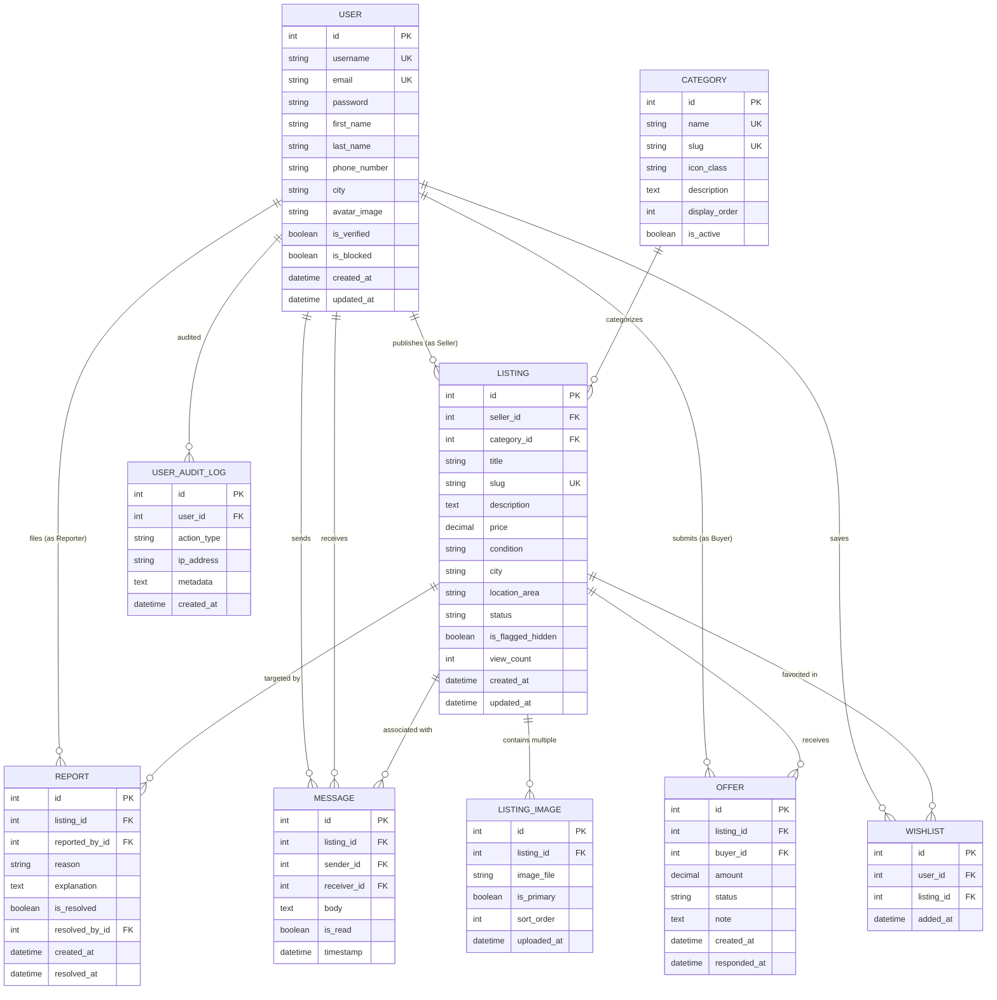

# GigBridge – PreLoved: Second-Hand Goods Marketplace
## Master Architecture, Algorithms & System Specification Document (Day 1 Deliverable)

---

## 1. Executive Summary & Project Identification

| Parameter | Specification |
| :--- | :--- |
| **Project Title** | **GigBridge – PreLoved: Second-Hand Goods Marketplace** |
| **Primary Domain** | Hyper-Local C2C (Consumer-to-Consumer) Sustainable Commerce |
| **Target Runtime** | Python 3.11+, Django 5.x, SQLite3 (Local / ACID-compliant) / PostgreSQL (Production ready) |
| **Frontend Stack** | HTML5, CSS3, Modern Bootstrap 5.3, Modern Vanilla JS (ES6+), Inter & Plus Jakarta Sans typography |
| **Real-time Core** | Hybrid Cursor-Based Live Feed Synchronization & Polling Engine / WebSocket Ready |
| **Media Handling** | Pillow (PIL) Automated Image Normalization, EXIF Stripping, WebP/JPEG Compression |
| **Design Aesthetic** | Inspired by **21st.dev** component libraries and **Awwwards** modern minimalist glassmorphism |
| **Delivery Schedule** | 5-Day Agile Sprint (Day 1: Documentation $\rightarrow$ Days 2-5: Implementation & Deployment) |

---

## 2. High-Level System Architecture

The PreLoved architecture enforces a decoupled, layered pattern ensuring rapid local query response times, strong isolation between buyer/seller logic, and zero-downtime background synchronization.

---

## 3. Real-Time Live Responsive Feed Engine (X1 ➔ X2, X3)

A core innovation of PreLoved is real-time catalog reactivity: when User X1 uploads a new listing, any active users (User X2, User X3) viewing the catalog see the new product appear automatically within 1 to 2 seconds without having to refresh their web browser.

### Key Architectural Highlights:
1. **Cursor-Indexed Delta Querying:** Clients only query for items created strictly after their highest known item ID (`ID > Current_Cursor`). This reduces database overhead to a single index-seek query.
2. **Bandwidth Optimization:** When no new items exist, the server returns an empty 32-byte JSON response, consuming negligible network resources.
3. **Fluid Entrance Micro-Animation:** When new products arrive, they slide into the top of the product grid using modern CSS cubic-bezier animations, alerting the buyer with an interactive live toast notification.
4. **Tab Inactivity Throttling:** When a user switches tabs, browser polling automatically suspends via the Page Visibility API, eliminating unnecessary background network traffic.

---

## 4. Core Algorithms & Logical Procedures (No Code Syntax)

### Algorithm 1: Real-Time Live Feed Delta Synchronization Engine
* **Objective:** Enable Users X2 and X3 to view new listings published by User X1 within 1–2 seconds without browser reloads, while minimizing database load and avoiding UI layout thrashing.
* **Inputs:** Client Cursor ID (integer), Category Filter (optional), City Filter (optional).
* **Outputs:** Array of newly published listings, Updated Cursor ID, Dynamic DOM Card Ingestion.
* **Procedural Execution Steps:**
  1. **Client Cursor Initialization:** Upon page load, the client browser parses the highest listing ID present in the initial server-rendered grid and initializes the tracking cursor variable (`Current_Cursor`).
  2. **Inactivity & Tab State Verification:** Before initiating a scheduled query, the client checks the Page Visibility API. If the browser tab is minimized or hidden, the poll is skipped to conserve system resources.
  3. **Asynchronous Delta Query Formulation:** At regular 2-second intervals, the client transmits an asynchronous request to the feed endpoint, passing the `Current_Cursor` along with any active category and city filter parameters.
  4. **Server-Side Index Seek:** The backend server queries the listings database using an indexed condition: ID strictly greater than `Current_Cursor`, status equals `ACTIVE`, and moderation flag equals false.
  5. **Batch Clamping & Normalization:** The server clamps the matched records to a maximum batch size of 20 items to prevent network saturation and serializes the listing metadata (title, price, condition, city, seller name, image URL).
  6. **Response Assembly & Cursor Advancement:** The server calculates the new maximum ID from the batch. If new items exist, it returns the items array along with the `New_Cursor`; otherwise, it returns an empty payload.
  7. **Client DOM Prepending & Animation Trigger:** The client browser iterates through the received items in reverse chronological order, constructs the card structure, prepends it to the top of the grid, and applies an entrance transition animation.
  8. **Live Alert Notification:** The client updates its tracking cursor to `New_Cursor` and triggers a temporary floating toast alert notifying the user of newly arrived items.

---

### Algorithm 2: Multi-Factor Catalog Search, Relevance Scoring & Spatial Filtering
* **Objective:** Provide fast, accurate, and multi-criteria product discovery combining full-text relevance, categorical boundaries, and geographic locality.
* **Inputs:** Keyword query string, Category slug, Minimum/Maximum price boundaries, Condition array, Target city, Sort preference.
* **Outputs:** Ranked, filtered, and paginated list of matching product listings.
* **Procedural Execution Steps:**
  1. **Base Candidate Filtering:** Retrieve the initial universe of listings restricted strictly to records with status equal to `ACTIVE` and visibility flag set to true.
  2. **Exact Attribute Partitioning:** Apply categorical and geographic filters. If a category slug is specified, filter by exact category match; if a city is provided, filter using case-insensitive match.
  3. **Continuous Numeric Boundary Clamping:** Enforce price bounds. If minimum price is defined, constrain price $\ge$ minimum; if maximum price is defined, constrain price $\le$ maximum.
  4. **Condition State Filtering:** If specific item conditions (e.g., 'Brand New', 'Like New') are selected by the buyer, filter records matching the requested condition tags.
  5. **Search String Tokenization:** If a keyword query is provided, sanitize and tokenize the search string into individual alphanumeric terms, discarding common stop words.
  6. **Multi-Field Weighted Relevance Scoring:** Evaluate each record against the search tokens: Title matches are assigned a weight factor of 3.0, while Description matches are assigned a weight factor of 1.0. Compute the composite relevance score for each candidate.
  7. **Hierarchical Multi-Criteria Sorting:** Sort the qualified candidate set: If relevance search is active, order primarily by descending relevance score, secondarily by creation date. If user selected explicit price sorting, order by price ascending or descending.
  8. **Deterministic Pagination Slicing:** Apply pagination offsets (default: 16 items per page) to yield consistent, high-performance catalog results.

---

### Algorithm 3: Price Offer Negotiation Finite State Automaton (FSM)
* **Objective:** Enforce transactional consistency, eliminate race conditions, and govern the formal price negotiation lifecycle between buyers and sellers.
* **Inputs:** Buyer identity, Listing reference, Proposed purchase amount, Seller decision action.
* **Outputs:** Deterministic state transition (`PENDING` $\rightarrow$ `ACCEPTED` / `REJECTED` / `CANCELLED` $\rightarrow$ `SOLD` / `EXPIRED`).
* **Procedural Execution Steps:**
  1. **Offer Inception & Self-Dealing Guard:** A registered buyer submits a price offer for an active listing. The system verifies that the buyer is not the seller of the item; self-offers are strictly rejected.
  2. **Price Sanity & Boundary Validation:** The proposed amount must fall within logical boundaries: minimum 10% of the listed price and maximum 150% of the listed price to prevent negative or absurd values.
  3. **Pending State Assignment:** The offer is registered with status `PENDING`, and an automated alert is routed to the seller's notifications and active chat thread.
  4. **Seller Evaluation & Branching Decision:** The seller reviews the offer and selects one of three actions: Accept, Reject, or Propose Counter-Offer.
  5. **Transition to 'ACCEPTED' State:** If the seller accepts: The offer status updates to `ACCEPTED`. The listing status automatically updates from `ACTIVE` to `DEAL_PENDING` to prevent duplicate offers. All other competing pending offers receive an automated notification.
  6. **Transition to 'REJECTED' State:** If the seller rejects: The offer status updates to `REJECTED`. The listing remains `ACTIVE` for other prospective buyers.
  7. **Buyer Withdrawal Transition:** Prior to seller acceptance, the buyer retains the right to withdraw the offer, transitioning the state to `CANCELLED`.
  8. **Final Deal Closure ('SOLD' Transition):** Following physical inspection and handoff, the seller clicks 'Mark as Sold'. The listing transitions to `SOLD`, all remaining pending or countered offers transition to `EXPIRED`, and the item is permanently delisted from live discovery feeds.

---

### Algorithm 4: Automated Image Optimization & EXIF Privacy Sanitization Pipeline
* **Objective:** Standardize user-submitted photos, reduce storage overhead, accelerate page load speeds, and permanently strip sensitive GPS location metadata.
* **Inputs:** Raw multipart image upload stream from user browser/mobile device.
* **Outputs:** Sanitized, oriented, Lanczos-scaled, compressed WebP image stored with UUID identifier.
* **Procedural Execution Steps:**
  1. **Binary Stream Verification:** Receive user-uploaded image stream and verify header magic bytes to ensure file is an authentic raster graphic (JPEG, PNG, WebP) and not an executable binary.
  2. **EXIF Orientation Transpose:** Read camera metadata orientation tags (EXIF tag 274) and rotate the image pixel matrix accordingly so mobile camera photos render upright.
  3. **Privacy & Geolocation Scrubbing:** Strip all embedded EXIF metadata, including GPS coordinates, camera serial numbers, and capture timestamps, completely shielding user location privacy.
  4. **Color Space Standardisation:** Examine image mode. If RGBA or Palette mode is detected, convert the matrix to standard 24-bit sRGB color space to ensure cross-browser rendering fidelity.
  5. **Proportional Dimension Clamping:** Evaluate pixel dimensions. If width exceeds 1440px or height exceeds 1080px, calculate the aspect-ratio preserved scaling factor and downscale the image using high-quality Lanczos resampling.
  6. **Modern WebP Lossy Compression:** Encode the normalized image into modern WebP format utilizing 82% quality target with dynamic Huffman coding, typically reducing file size by 65-80% compared to raw JPEG.
  7. **Secure In-Memory Buffer Re-Encapsulation:** Assign a cryptographically secure UUIDv4 filename, package the compressed binary into an in-memory file structure, and commit to local media directory storage.

---

### Algorithm 5: Automated Content Moderation & Abuse Scoring Heuristics
* **Objective:** Protect the marketplace against counterfeit goods, spam, prohibited items, and malicious actors through automated risk detection and community velocity triggers.
* **Inputs:** Listing text corpus, Listed price, Seller transaction history, User report logs.
* **Outputs:** Numerical Risk Score, Automated Visibility Status (Active / Hidden Under Review), Admin Moderation Queue Entry.
* **Procedural Execution Steps:**
  1. **Text Corpus Extraction & Normalization:** Combine listing title and description into a unified text string, convert all characters to lowercase, and strip punctuation marks.
  2. **Prohibited Lexicon Scanning:** Iterate through the platform's prohibited term dictionary (counterfeits, weapons, illicit substances, stolen goods). Each occurrence increments the listing's Risk Score by 50 points.
  3. **Price Anomaly Heuristic Evaluation:** Cross-reference detected high-value item keywords (e.g., flagship mobile phones) against listed asking prices. An asking price below 10% of typical market baseline increments the Risk Score by 30 points.
  4. **Seller Trust & Maturity Factor:** Examine seller account age and completed sales volume. A newly created account listing high-value items on day one increments the Risk Score by 10 points.
  5. **Automated Threshold Action:** If the composite Risk Score meets or exceeds 50 points, the system automatically sets the listing's visibility flag to false (hidden from public catalog) and queues an urgent incident in the Admin Moderation Hub.
  6. **Community Velocity Trigger:** Continuously monitor user report counts. If any active listing receives 3 or more independent reports from verified user accounts within a 24-hour window, the listing is automatically hidden from public search pending staff resolution.

---

## 5. End-to-End System Workflows

---

## 6. Comprehensive Database Entity Relationship Diagram (ERD)

---

## 7. REST & Real-Time API Endpoint Catalog

| Method | Endpoint | Access | Purpose & Request / Response Contract |
| :--- | :--- | :--- | :--- |
| **GET** | `/api/v1/feed/live/` | Public | **Cursor Delta Live Feed** Query: `?after_id=45&category=2` Response: `{ "count": 1, "new_cursor": 46, "items": [...] }` |
| **GET** | `/api/v1/listings/` | Public | **Catalog Filter & Search** Query: `?q=iphone&min_price=10000&city=Ahmedabad` Response: Paginated array of listing objects |
| **POST**| `/api/v1/listings/create/`| Auth | **Create New Listing** Body: Multipart form data with fields & image files |
| **POST**| `/api/v1/listings/<id>/wishlist/`| Auth | **Toggle Saved Item** Response: `{ "favorited": true, "total_wishlist": 4 }` |
| **POST**| `/api/v1/listings/<id>/offers/`| Auth | **Submit Price Offer** Body: `{ "amount": 15000.00 }` Response: `{ "offer_id": 12, "status": "PENDING" }` |
| **POST**| `/api/v1/offers/<id>/respond/`| Seller | **Accept / Reject Offer** Body: `{ "decision": "ACCEPT" }` Response: `{ "status": "ACCEPTED", "deal_pending": true }` |
| **GET** | `/api/v1/chat/<listing_id>/messages/`| Auth | **Fetch Conversation History** Response: Array of chronological messages |
| **POST**| `/api/v1/chat/<listing_id>/send/`| Auth | **Send Chat Message** Body: `{ "body": "Is this still available for meetup?" }` |
| **POST**| `/api/v1/listings/<id>/report/`| Auth | **File Content Violation Report** Body: `{ "reason": "FAKE_ITEM", "details": "..." }` |
| **POST**| `/api/v1/admin/moderate/`| Staff | **Admin Sanction User / Delete Listing** Body: `{ "listing_id": 8, "action": "REMOVE_AND_BAN" }` |

---

## 8. 5-Day Delivery Schedule & Milestones Tracker

| Day | Strategic Milestone | Expected Deliverables & Outputs | Status |
| :---: | :--- | :--- | :---: |
| **Day 1** | **System Documentation & Architecture** | Complete SRS, database ERD, theoretical algorithms, live feed engine specifications, API contracts, and formatted Word document deliverable. | ✅ **Completed** |
| **Day 2** | **Core Platform, Data Models & Admin Governance** | Django project structure setup, Custom User model, Category and Listing models, Pillow image processing pipeline, and admin moderation hub. | ⏳ Scheduled |
| **Day 3** | **Marketplace Catalog, Search & Listing Studio** | Seller multi-photo listing submission studio, keyword search engine, dynamic price sliders, condition filters, and wishlist module. | ⏳ Scheduled |
| **Day 4** | **Live Responsive Feed, Chat & Negotiations** | Implementation of the real-time live feed engine (1-2s delay X1 ➔ X2, X3), 1-on-1 buyer-seller direct messaging, and price offer negotiation state machine. | ⏳ Scheduled |
| **Day 5** | **UI Polish, Verification & Final Deployment** | 21st.dev/Awwwards visual refinement, cross-browser multi-user simulation testing, final validation, and code push to GitHub once permissions are confirmed. | ⏳ Scheduled |
