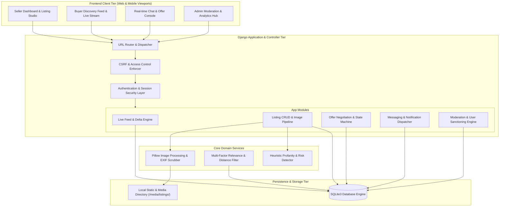
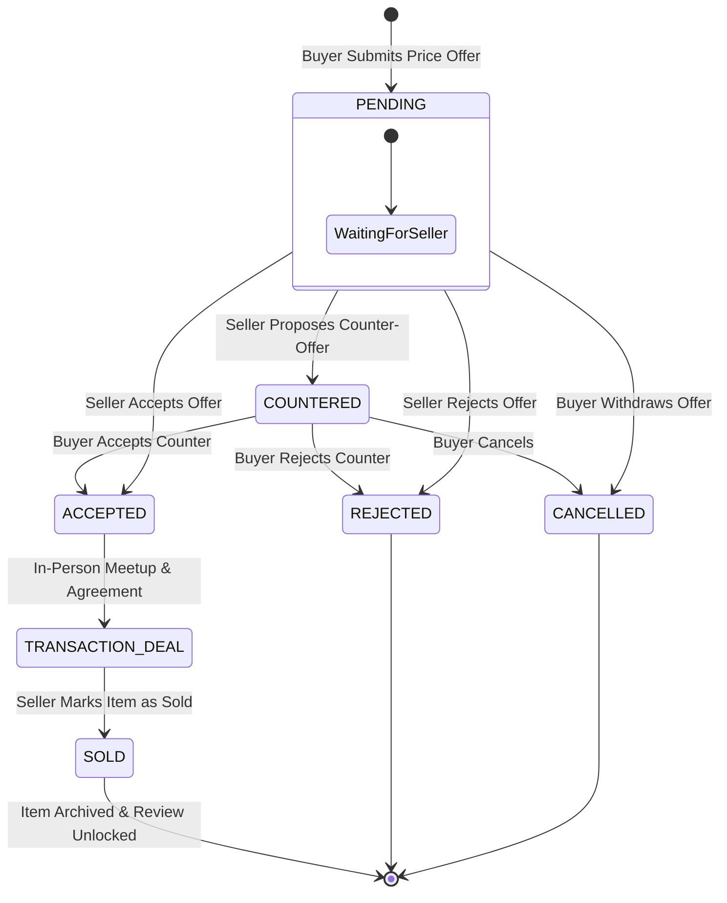
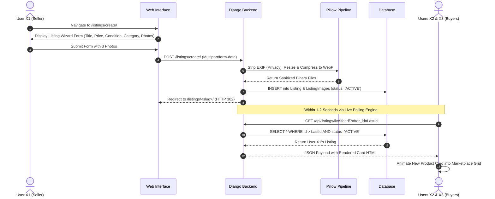
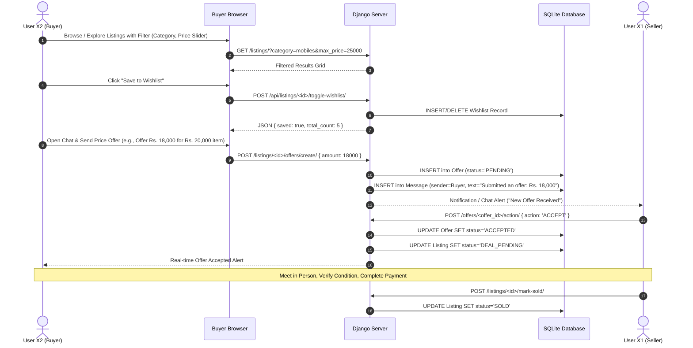
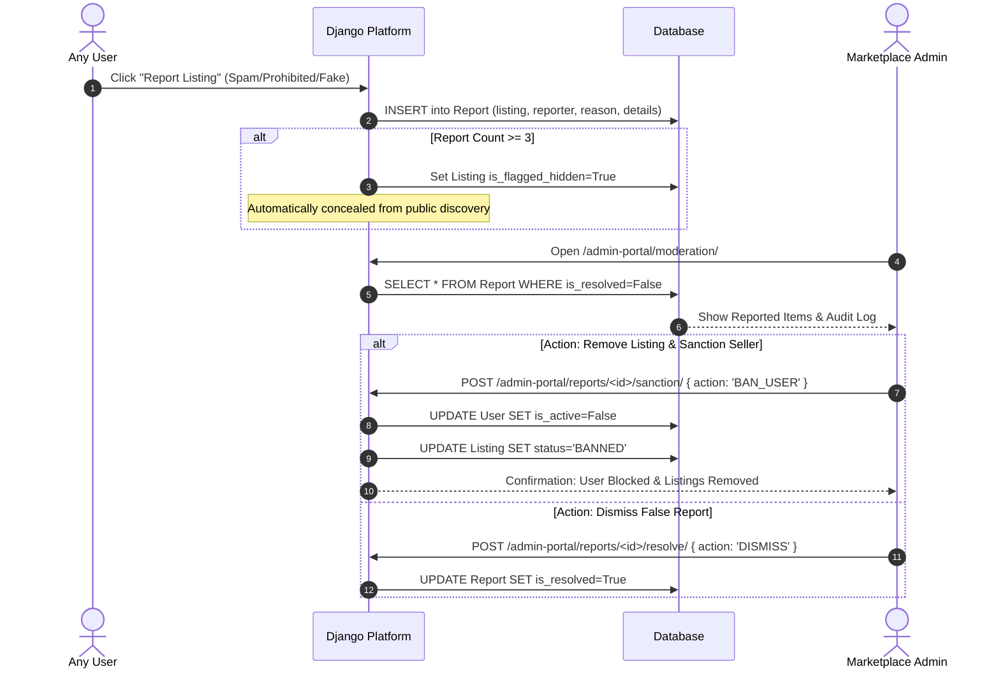
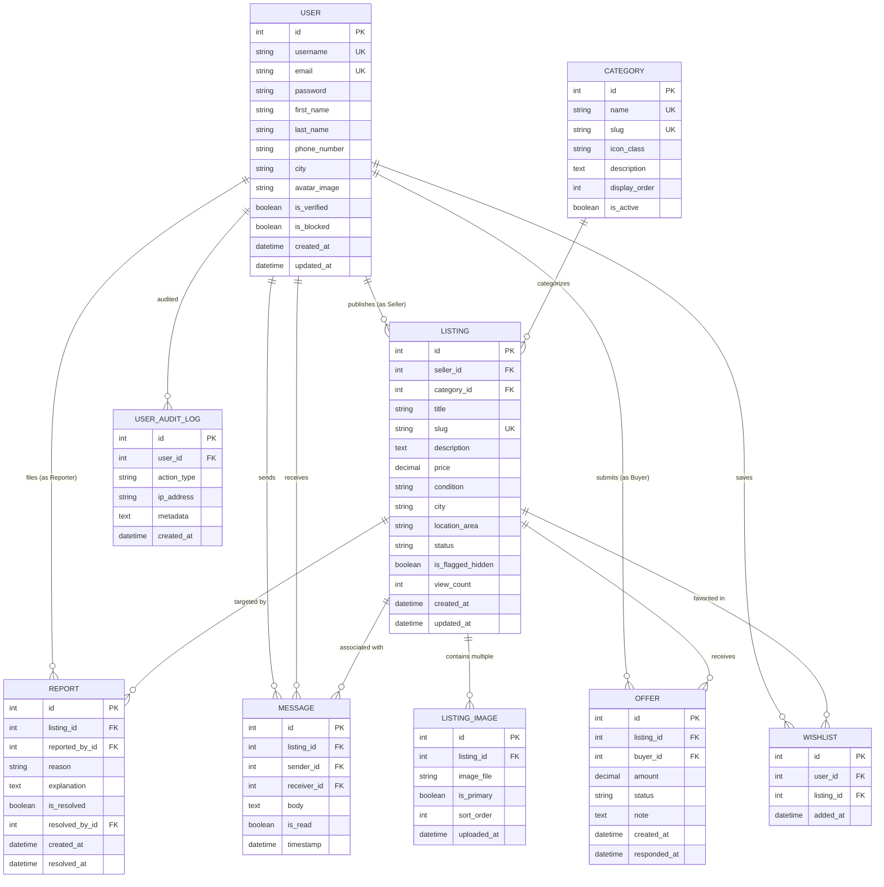
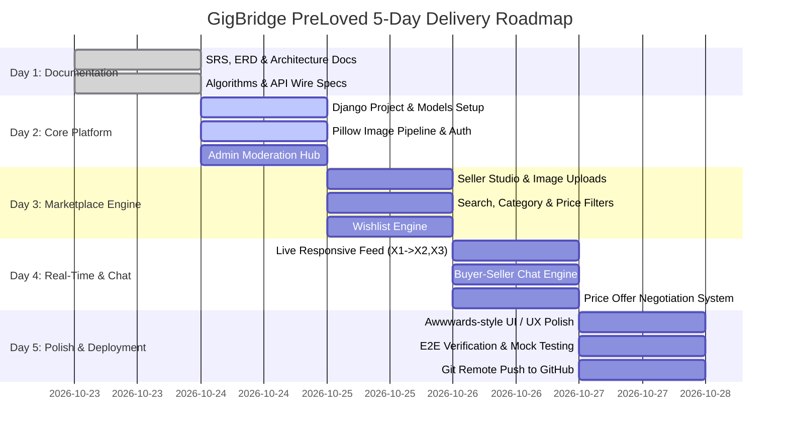

# GigBridge – PreLoved: Second-Hand Goods Marketplace
## Master Architecture, Algorithms & System Specification Document (Day 1 Deliverable)

---

## 1. Executive Summary & Project Identification

| Parameter | Specification |
| :--- | :--- |
| **Project Title** | **GigBridge – PreLoved: Second-Hand Goods Marketplace** |
| **Primary Domain** | Hyper-Local C2C (Consumer-to-Consumer) Sustainable Commerce |
| **Target Runtime** | Python 3.11+, Django 5.x, SQLite3 (Local / ACID-compliant) / PostgreSQL (Production ready) |
| **Frontend Stack** | HTML5, CSS3, Modern Bootstrap 5.3, Modern Vanilla JS (ES6+), Inter & Plus Jakarta Sans typography |
| **Real-time Core** | Hybrid Cursor-Based Live Feed Synchronization & Polling Engine / WebSocket Ready |
| **Media Handling** | Pillow (PIL) Automated Image Normalization, EXIF Stripping, WebP/JPEG Compression |
| **Design Aesthetic** | Inspired by **21st.dev** component libraries and **Awwwards** modern minimalist glassmorphism |
| **Delivery Schedule** | 5-Day Agile Sprint (Day 1: Documentation $\rightarrow$ Days 2-5: Implementation & Deployment) |

---

## 2. High-Level System Architecture

The PreLoved architecture enforces a decoupled, layered pattern ensuring rapid local query response times, strong isolation between buyer/seller logic, and zero-downtime background synchronization.



---

## 3. Core Algorithms & Detailed Pseudocode

### Algorithm 1: Real-Time Delta Feed Synchronization Engine (X1 $\rightarrow$ X2, X3)
* **Objective:** Enable Users X2 and X3 to view new listings published by User X1 within 1–2 seconds without browser reloads, while minimizing database load and avoiding UI layout thrashing.
* **Mechanism:** Cursor-indexed delta querying with client-side optimistic animation queue.

```python
"""
ALGORITHM 1: Cursor-Based Live Feed Polling & Batch Injection
Context: Client Browser (X2, X3) executes interval query to Django API endpoint.
"""

# Backend Controller Logic (views.py)
function get_live_feed_delta(request):
    client_cursor_id = parse_integer(request.GET.get('after_id', default=0))
    selected_category = request.GET.get('category_id', default=None)
    selected_city = request.GET.get('city', default=None)
    
    # Query only approved, active items created strictly AFTER the client's current max ID
    delta_query = Listing.objects.filter(
        id__gt=client_cursor_id,
        status='ACTIVE',
        is_flagged_hidden=False
    ).select_related('seller', 'category').prefetch_related('images').order_by('created_at')
    
    if selected_category:
        delta_query = delta_query.filter(category_id=selected_category)
    if selected_city:
        delta_query = delta_query.filter(city__iexact=selected_city)
        
    delta_items = delta_query[:20]  # Clamped batch size to prevent flood
    
    serialized_payload = []
    for item in delta_items:
        serialized_payload.append({
            "id": item.id,
            "title": sanitize_html(item.title),
            "price": float(item.price),
            "condition": item.condition,
            "city": item.city,
            "created_at_human": item.created_at.timesince(),
            "primary_image_url": item.primary_image.url if item.primary_image else "/static/img/placeholder.webp",
            "seller_name": item.seller.get_full_name() or item.seller.username,
            "rendered_card_html": render_to_string("partials/card_feed_item.html", {"listing": item})
        })
        
    new_max_cursor = max([item['id'] for item in serialized_payload], default=client_cursor_id)
    
    return JsonResponse({
        "status": "success",
        "count": len(serialized_payload),
        "new_cursor": new_max_cursor,
        "items": serialized_payload
    })
```

```javascript
/* Client-Side Ingestion & Animation Loop (JavaScript) */
class LiveFeedEngine {
    constructor(feedContainerId, pollIntervalMs = 2000) {
        this.container = document.getElementById(feedContainerId);
        this.highestCursorId = parseInt(this.container.dataset.initialCursor || 0);
        this.pollInterval = pollIntervalMs;
        this.isPollingActive = true;
        this.init();
    }

    init() {
        setInterval(() => this.fetchDelta(), this.pollInterval);
    }

    async fetchDelta() {
        if (document.hidden) return; // Tab optimization: throttle when inactive
        
        try {
            const url = `/api/listings/live-feed/?after_id=${this.highestCursorId}`;
            const response = await fetch(url, { credentials: 'same-origin' });
            if (!response.ok) return;

            const data = await response.json();
            if (data.count > 0) {
                this.injectNewItems(data.items);
                this.highestCursorId = data.new_cursor;
            }
        } catch (error) {
            console.debug("Feed poll skipped:", error);
        }
    }

    injectNewItems(items) {
        // Items ordered from oldest to newest; prepend in reverse order
        items.forEach(item => {
            const wrapper = document.createElement('div');
            wrapper.innerHTML = item.rendered_card_html.trim();
            const cardEl = wrapper.firstElementChild;

            // Apply Awwwards-style entrance class (CSS slide-fade down)
            cardEl.classList.add('feed-item-incoming');
            this.container.prepend(cardEl);

            // Trigger reflow & remove incoming class to start fluid transition
            requestAnimationFrame(() => {
                cardEl.classList.add('feed-item-visible');
            });
        });

        this.triggerLiveToastAlert(items.length);
    }

    triggerLiveToastAlert(count) {
        const toast = document.getElementById('live-feed-toast');
        if (toast) {
            toast.textContent = `⚡ ${count} new item(s) listed just now!`;
            toast.classList.add('show');
            setTimeout(() => toast.classList.remove('show'), 3500);
        }
    }
}
```

---

### Algorithm 2: Multi-Factor Relevance & Location Ranking Algorithm
* **Objective:** Enable Buyers to filter across Categories, Price Sliders, City, and Condition with fast keyword ranking.

```python
"""
ALGORITHM 2: Multi-Factor Product Filtering & Score-Ranked Catalog Search
"""
function search_and_filter_listings(params):
    base_qs = Listing.objects.filter(status='ACTIVE', is_flagged_hidden=False)

    # 1. Exact Categorical & Geographic Constraints
    if params.get('category_slug'):
        base_qs = base_qs.filter(category__slug=params['category_slug'])
    if params.get('city'):
        base_qs = base_qs.filter(city__iexact=params['city'])
    if params.get('condition'):
        base_qs = base_qs.filter(condition=params['condition'])

    # 2. Continuous Numeric Range Bounds
    if params.get('min_price'):
        base_qs = base_qs.filter(price__gte=Decimal(params['min_price']))
    if params.get('max_price'):
        base_qs = base_qs.filter(price__lte=Decimal(params['max_price']))

    # 3. Text Relevance Weighting (Title = 3x, Description = 1x)
    query_string = params.get('q', '').strip()
    if query_string:
        keywords = query_string.split()
        title_q = Q()
        desc_q = Q()
        for kw in keywords:
            title_q |= Q(title__icontains=kw)
            desc_q |= Q(description__icontains=kw)

        base_qs = base_qs.filter(title_q | desc_q).annotate(
            relevance_score=(
                Case(When(title_q, then=Value(3)), default=Value(0), output_field=IntegerField()) +
                Case(When(desc_q, then=Value(1)), default=Value(0), output_field=IntegerField())
            )
        ).order_by('-relevance_score', '-created_at')
    else:
        # Default sort order: Recent listings first
        sort_choice = params.get('sort', 'newest')
        if sort_choice == 'price_low_high':
            base_qs = base_qs.order_by('price')
        elif sort_choice == 'price_high_low':
            base_qs = base_qs.order_by('-price')
        else:
            base_qs = base_qs.order_by('-created_at')

    return base_qs
```

---

### Algorithm 3: Offer & Negotiation State Machine (Finite State Automaton)

The Offer Negotiation lifecycle guarantees that once a seller accepts an offer, competing pending offers are flagged and item status updates without race conditions.



#### State Transition Validation Logic:
1. **Rule 1 (Price Sanity):** An offer must satisfy `0.10 * listing.price <= offer.amount <= 1.50 * listing.price`.
2. **Rule 2 (Anti-Self Dealing):** A user cannot submit an offer on their own listing (`buyer != seller`).
3. **Rule 3 (Exclusivity on Acceptance):** When an offer transitions to `ACCEPTED`:
   * Listing status updates from `ACTIVE` to `DEAL_PENDING`.
   * All other `PENDING` offers on that listing receive an automated system notice: `"Another offer has been accepted"`.
4. **Rule 4 (Mark as Sold Closure):** When the listing transitions to `SOLD`:
   * All non-accepted offers transition to `EXPIRED`.
   * Listing is delisted from live public feeds.

---

### Algorithm 4: Automated Moderation & Risk Scoring Pipeline
* **Objective:** Prevent prohibited items (counterfeit goods, prohibited substances, harassment, spam) and automatically shield users before manual administrator intervention.

```python
"""
ALGORITHM 4: Automated Moderation & Report Risk Velocity
"""
BLOCKED_KEYWORDS = ["stolen", "fake", "replica", "weapons", "drugs", "counterfeit", "passport"]

function evaluate_listing_risk(listing):
    risk_score = 0
    text_corpus = (listing.title + " " + listing.description).lower()

    # 1. Prohibited Dictionary Scan
    for word in BLOCKED_KEYWORDS:
        if word in text_corpus:
            risk_score += 50

    # 2. Anomalous Price Heuristic (e.g., iPhone 15 listed for Rs. 500)
    if "iphone" in text_corpus and listing.price < 2000:
        risk_score += 30

    # 3. New User Multiplier
    if listing.seller.listings.count() == 0:
        risk_score += 10

    if risk_score >= 50:
        listing.is_flagged_hidden = True
        listing.moderation_status = 'UNDER_REVIEW'
        Report.objects.create(
            listing=listing,
            reported_by=User.get_sentinel_bot(),
            reason="AUTO_FLAGGED_HIGH_RISK_SCORE",
            details=f"System flagged listing with automated risk score: {risk_score}"
        )
    else:
        listing.moderation_status = 'APPROVED'
    
    listing.save()
```

---

### Algorithm 5: Multi-Format Image Optimization & EXIF Privacy Pipeline
* **Objective:** Strip sensitive geographic metadata (GPS coordinates from mobile camera photos) to protect user location privacy, while compressing image sizes to guarantee fast loading speeds.

```python
"""
ALGORITHM 5: Secure Image Sanitization & Compression Pipeline
Using Python Pillow (PIL)
"""
from PIL import Image, ImageOps
import io
from django.core.files.uploadedfile import InMemoryUploadedFile

function process_listing_image(uploaded_file):
    # 1. Open with Pillow
    img = Image.open(uploaded_file)
    
    # 2. Fix orientation based on camera EXIF, then strip ALL EXIF (GPS, Camera ID)
    img = ImageOps.exif_transpose(img)
    
    # 3. Convert RGBA / Palette mode to RGB for standardized WebP/JPEG encoding
    if img.mode in ("RGBA", "P"):
        img = img.convert("RGB")
        
    # 4. Clamped Resizing (Max bounding box: 1440px x 1080px)
    max_dims = (1440, 1080)
    img.thumbnail(max_dims, Image.Resampling.LANCZOS)
    
    # 5. Compress to modern WebP format at 82% quality
    output_buffer = io.BytesIO()
    img.save(output_buffer, format="WEBP", quality=82, optimize=True)
    output_buffer.seek(0)
    
    # 6. Re-encapsulate into Django UploadedFile object
    sanitized_file = InMemoryUploadedFile(
        file=output_buffer,
        field_name='image',
        name=uploaded_file.name.rsplit('.', 1)[0] + '.webp',
        content_type='image/webp',
        size=output_buffer.getbuffer().nbytes,
        charset=None
    )
    return sanitized_file
```

---

## 4. End-to-End System Workflows

### 4.1 Seller Journey: Listing Publishing & Status Lifecycle



### 4.2 Buyer Journey: Discovery, Chat & Offer Negotiation



### 4.3 Administrator Journey: Governance & Moderation



---

## 5. Comprehensive Database Entity Relationship Diagram (ERD)



---

## 6. Complete Data Dictionary

### 6.1 `users_customuser`
| Field Name | Type | Null/Blank | Default | Constraints / Description |
| :--- | :--- | :--- | :--- | :--- |
| `id` | BigAutoField | No | Auto | Primary Key |
| `username` | CharField(150) | No | None | Unique username |
| `email` | EmailField(254) | No | None | Unique login & communication email |
| `phone_number` | CharField(15) | Yes / Yes | None | Contact for WhatsApp / SMS negotiations |
| `city` | CharField(100) | No | 'Ahmedabad' | Primary geographical trading city |
| `avatar` | ImageField | Yes / Yes | 'avatars/default.png' | Profile display picture (processed by Pillow) |
| `is_blocked` | BooleanField | No | False | Admin suspension lock |
| `date_joined` | DateTimeField | No | timezone.now | Account registration timestamp |

### 6.2 `listings_category`
| Field Name | Type | Null/Blank | Default | Constraints / Description |
| :--- | :--- | :--- | :--- | :--- |
| `id` | AutoField | No | Auto | Primary Key |
| `name` | CharField(100) | No | None | e.g., "Mobiles", "Laptops", "Books", "Furniture" |
| `slug` | SlugField(120) | No | None | Unique URL slug |
| `icon_svg` | CharField(100) | No | 'bi-tag' | Bootstrap Icons identifier class |
| `is_active` | BooleanField | No | True | Category visibility toggle |

### 6.3 `listings_listing`
| Field Name | Type | Null/Blank | Default | Constraints / Description |
| :--- | :--- | :--- | :--- | :--- |
| `id` | BigAutoField | No | Auto | Primary Key (used as cursor for live delta) |
| `seller_id` | ForeignKey(User) | No | None | Cascades on User Delete |
| `category_id`| ForeignKey(Category)| No | None | Protected on Delete |
| `title` | CharField(200) | No | None | Descriptive item headline |
| `slug` | SlugField(250) | No | None | Unique SEO slug |
| `description`| TextField | No | None | Detailed specifications & wear details |
| `price` | DecimalField(10,2)| No | None | Listed asking price in INR (Rs.) |
| `condition` | CharField(20) | No | 'GOOD' | Choices: `BRAND_NEW`, `LIKE_NEW`, `GOOD`, `FAIR` |
| `city` | CharField(100) | No | None | City location for local handoff |
| `status` | CharField(20) | No | 'ACTIVE' | Choices: `ACTIVE`, `DEAL_PENDING`, `SOLD`, `ARCHIVED` |
| `is_flagged_hidden` | BooleanField | No | False | Hide flag for flagged items under review |
| `view_count` | PositiveIntegerField| No | 0 | Engagement counter |
| `created_at` | DateTimeField | No | timezone.now | Index for feed ordering |

### 6.4 `listings_listingimage`
| Field Name | Type | Null/Blank | Default | Constraints / Description |
| :--- | :--- | :--- | :--- | :--- |
| `id` | BigAutoField | No | Auto | Primary Key |
| `listing_id` | ForeignKey(Listing)| No | None | Cascade Delete on Listing |
| `image` | ImageField | No | None | Compressed `.webp` storage path |
| `is_primary` | BooleanField | No | False | Primary thumbnail displayed in grid |

### 6.5 `trading_offer`
| Field Name | Type | Null/Blank | Default | Constraints / Description |
| :--- | :--- | :--- | :--- | :--- |
| `id` | BigAutoField | No | Auto | Primary Key |
| `listing_id` | ForeignKey(Listing)| No | None | Cascade on Listing Delete |
| `buyer_id` | ForeignKey(User) | No | None | Submitting Buyer User |
| `amount` | DecimalField(10,2)| No | None | Proposed purchase price |
| `status` | CharField(20) | No | 'PENDING' | Choices: `PENDING`, `ACCEPTED`, `REJECTED`, `EXPIRED`, `CANCELLED` |
| `created_at` | DateTimeField | No | timezone.now | Submission timestamp |

### 6.6 `chat_message`
| Field Name | Type | Null/Blank | Default | Constraints / Description |
| :--- | :--- | :--- | :--- | :--- |
| `id` | BigAutoField | No | Auto | Primary Key |
| `listing_id` | ForeignKey(Listing)| No | None | Association to product thread |
| `sender_id` | ForeignKey(User) | No | None | Author of message |
| `receiver_id`| ForeignKey(User) | No | None | Target recipient |
| `body` | TextField | No | None | Text content |
| `is_read` | BooleanField | No | False | Read receipt tracking |
| `timestamp` | DateTimeField | No | timezone.now | Message timestamp |

### 6.7 `moderation_report`
| Field Name | Type | Null/Blank | Default | Constraints / Description |
| :--- | :--- | :--- | :--- | :--- |
| `id` | BigAutoField | No | Auto | Primary Key |
| `listing_id` | ForeignKey(Listing)| No | None | Target reported listing |
| `reported_by`| ForeignKey(User) | No | None | Reporter User |
| `reason` | CharField(50) | No | None | `FAKE_ITEM`, `PROHIBITED`, `SPAM`, `HARASSMENT` |
| `details` | TextField | Yes / Yes | None | Supporting user complaint text |
| `is_resolved`| BooleanField | No | False | Admin resolution flag |

---

## 7. REST & Real-Time API Endpoint Catalog

| Method | Endpoint | Access | Purpose & Request / Response Contract |
| :--- | :--- | :--- | :--- |
| **GET** | `/api/v1/feed/live/` | Public | **Cursor Delta Live Feed**<br>Query: `?after_id=45&category=2`<br>Response: `{ "count": 1, "new_cursor": 46, "items": [...] }` |
| **GET** | `/api/v1/listings/` | Public | **Catalog Filter & Search**<br>Query: `?q=iphone&min_price=10000&city=Ahmedabad`<br>Response: Paginated array of listing objects |
| **POST**| `/api/v1/listings/create/`| Auth | **Create New Listing**<br>Body: `multipart/form-data` with fields & image files |
| **POST**| `/api/v1/listings/<id>/wishlist/`| Auth | **Toggle Saved Item**<br>Response: `{ "favorited": true, "total_wishlist": 4 }` |
| **POST**| `/api/v1/listings/<id>/offers/`| Auth | **Submit Price Offer**<br>Body: `{ "amount": 15000.00 }`<br>Response: `{ "offer_id": 12, "status": "PENDING" }` |
| **POST**| `/api/v1/offers/<id>/respond/`| Seller | **Accept / Reject Offer**<br>Body: `{ "decision": "ACCEPT" }`<br>Response: `{ "status": "ACCEPTED", "deal_pending": true }` |
| **GET** | `/api/v1/chat/<listing_id>/messages/`| Auth | **Fetch Conversation History**<br>Response: Array of chronological messages |
| **POST**| `/api/v1/chat/<listing_id>/send/`| Auth | **Send Chat Message**<br>Body: `{ "body": "Is this still available for meetup?" }` |
| **POST**| `/api/v1/listings/<id>/report/`| Auth | **File Content Violation Report**<br>Body: `{ "reason": "FAKE_ITEM", "details": "..." }` |
| **POST**| `/api/v1/admin/moderate/`| Staff | **Admin Sanction User / Delete Listing**<br>Body: `{ "listing_id": 8, "action": "REMOVE_AND_BAN" }` |

---

## 8. UI/UX Design System Specification (21st.dev & Awwwards Aesthetic)

To stand out like modern award-winning applications (such as 21st.dev and Awwwards honorees), the PreLoved UI rejects clunky default forms in favor of clean, micro-animated minimalism:

```
┌────────────────────────────────────────────────────────────────────────┐
│  ⚡ PRELOVED       [🔍 Search mobiles, books...]      Wishlist (3)  👤 │
├────────────────────────────────────────────────────────────────────────┤
│  Categories: [📱 Mobiles]  [💻 Laptops]  [📚 Books]  [🛋️ Furniture]    │
├────────────────────────────────────────────────────────────────────────┤
│  ⚡ LIVE MARKETPLACE FEED                                              │
│  ┌──────────────────┐  ┌──────────────────┐  ┌──────────────────┐     │
│  │ [Image - WebP]   │  │ [Image - WebP]   │  │ [Image - WebP]   │     │
│  │ iPhone 13 128GB  │  │ Ergonomic Desk   │  │ Clean Code Book  │     │
│  │ ₹ 34,999  • Like │  │ ₹ 4,500  • Good  │  │ ₹ 450  • Fair    │     │
│  │ 📍 Ahmedabad     │  │ 📍 Surat         │  │ 📍 Vadodara      │     │
│  │ [Make Offer] [♡] │  │ [Make Offer] [♡] │  │ [Make Offer] [♡] │     │
│  └──────────────────┘  └──────────────────┘  └──────────────────┘     │
└────────────────────────────────────────────────────────────────────────┘
```

### 8.1 Design Tokens & Color Palette
* **Background Canvas:** `#090D16` (Deep Midnight Obsidian) or `#F8FAFC` (Clean Crisp Ceramic Light Mode).
* **Card Surface:** Glassmorphic translucent surface `rgba(255, 255, 255, 0.7)` with `backdrop-filter: blur(16px)` and subtle `1px solid rgba(226, 232, 240, 0.8)` border.
* **Accent Primary:** `#4F46E5` (Electric Indigo) with hover state `#4338CA`.
* **Accent Success / Live Glow:** `#10B981` (Emerald Glow) with pulsing CSS keyframe animation for the live feed indicator.
* **Warning / Condition Pill:** Amber `#F59E0B` for Good/Fair condition tags.

### 8.2 Micro-Interactions & Animation Specs
1. **Live Feed Card Insertion:**
   ```css
   @keyframes liveCardSlideDown {
       0% {
           opacity: 0;
           transform: translateY(-24px) scale(0.96);
       }
       100% {
           opacity: 1;
           transform: translateY(0) scale(1);
       }
   }
   .feed-item-incoming {
       animation: liveCardSlideDown 450ms cubic-bezier(0.16, 1, 0.3, 1) forwards;
   }
   ```
2. **Live Heart Wishlist Ripple:** Instant optimistic state toggle with a 1.25x scale bounce on click.
3. **Skeleton Shimmer Loading:** Subtle linear-gradient shimmer on image placeholders before WebP frames hydrate.

---

## 9. Security, Sanitization & Performance Guardrails

1. **CSRF Enforcement:** All state-mutating requests (POST, PUT, DELETE) mandate the Django `csrf_token` in headers (`X-CSRFToken`).
2. **Media Path Hardening:** User-uploaded file names are sanitized using UUIDv4 hashes to prevent path traversal (`../../etc/passwd`) attacks.
3. **MIME Type Validation:** Magic byte inspection prevents executable binaries (`.exe`, `.sh`) disguised with image extensions (`.png`) from reaching storage.
4. **SQL Injection Resistance:** 100% of queries use Django ORM parameter binding; no raw SQL concatenations.
5. **XSS Protection:** All template contexts escape outputs automatically; chat messages are sanitized with strict plain-text escaping.
6. **Rate Limiting:** IP/User-based throttling limits offer submissions to maximum 10 offers per 5-minute window to eliminate bot harassment.

---

## 10. 5-Day Delivery Schedule & Milestones Tracker


